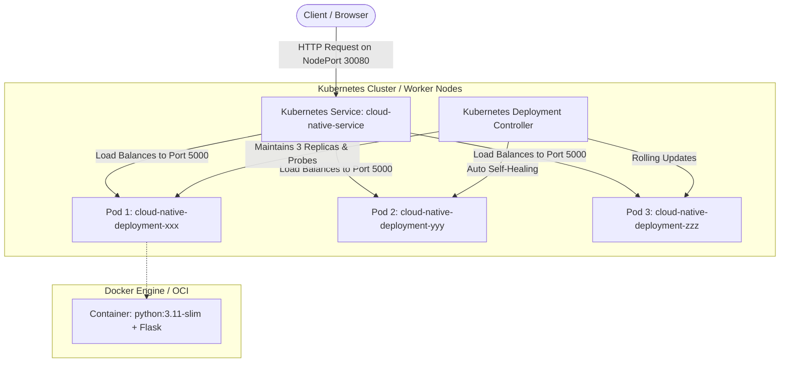

# Activity 1: Containerization and Deployment of a Cloud-Native Application
**Course**: DevOps & Cloud-Native Engineering  
**Student Name**: Yash Sabale  
**Repository**: [https://github.com/YashSabale01/ShalaConnect01](https://github.com/YashSabale01/ShalaConnect01)  

---

## 📌 1. Project Overview & Architecture

This project demonstrates the end-to-end containerization and orchestration lifecycle of a production-ready cloud-native Python web microservice using **Docker** and **Kubernetes**. 

### Architecture Topology


---

## 📋 2. Project File Structure
```text
cloud-native-app/
├── app.py                  # Cloud-native Flask web microservice with /healthz & system telemetry
├── requirements.txt        # Pinned production Python dependencies
├── Dockerfile              # Multi-step optimized Dockerfile with non-root user & healthcheck
├── .dockerignore           # Excludes temporary cache files & git metadata
├── README.md               # Complete architecture, execution guide, and verification steps
└── k8s/
    ├── deployment.yaml     # 3 Replicas, RollingUpdate, Resource Limits/Requests, Liveness/Readiness
    └── service.yaml        # NodePort Service exposing application on port 30080
```

---

## 🚀 3. Step-by-Step Execution Guide & Screenshot Checklist

### Step 0: Ensure Docker & Kubernetes are Active
1. **Docker Desktop**: Open Docker Desktop from the Start menu. Verify the engine is running.
2. **Enable Kubernetes in Docker Desktop**:
   - Go to **Settings (Gear Icon ⚙️)** $\rightarrow$ **Kubernetes**.
   - Check **"Enable Kubernetes"** $\rightarrow$ Click **"Apply & restart"**.
   - Wait until the Kubernetes status icon in the bottom-left turns green.

---

### Step 1: Docker Build & Verification (Rubric: Dockerfile & Image Creation - 5/5)
Open PowerShell and navigate to the project directory:
```powershell
cd "d:\devops assignments\shalaconect01\cloud-native-app"
```

Build the custom Docker container image:
```powershell
docker build -t cloud-native-app:v1 .
```

List the newly built Docker image:
```powershell
docker images cloud-native-app:v1
```

> 📸 **Screenshot 1 To Capture**: Terminal showing `docker build -t cloud-native-app:v1 .` completing successfully and `docker images cloud-native-app:v1` displaying the image repository, tag, and size.

---

### Step 2: Docker Container Execution & Local Verification (Rubric: Container Execution - 5/5)
Run the application inside a standalone Docker container:
```powershell
docker run -d -p 5000:5000 --name local-cloud-container cloud-native-app:v1
```

Verify the running container and its health status:
```powershell
docker ps --filter "name=local-cloud-container"
```

Verify container logs:
```powershell
docker logs local-cloud-container
```

Test application response and health endpoint:
```powershell
curl http://localhost:5000/healthz
```
Open in Browser: [http://localhost:5000](http://localhost:5000)

> 📸 **Screenshot 2 To Capture**: 
> 1. Terminal showing `docker ps`, `docker logs`, and `curl http://localhost:5000/healthz`.
> 2. Web browser showing the interactive dashboard at `http://localhost:5000` with container hostname and status "Healthy & Running".

Clean up standalone container before Kubernetes deployment:
```powershell
docker stop local-cloud-container
docker rm local-cloud-container
```

---

### Step 3: Kubernetes Deployment (Rubric: Kubernetes Deployment - 5/5)
Apply the Kubernetes Deployment manifest:
```powershell
kubectl apply -f k8s/deployment.yaml
```

Verify Deployment, ReplicaSet, and Pods:
```powershell
kubectl get deployments
kubectl get replicasets
kubectl get pods -o wide
```

Check detailed deployment rollout status:
```powershell
kubectl rollout status deployment/cloud-native-deployment
kubectl describe deployment cloud-native-deployment
```

> 📸 **Screenshot 3 To Capture**: Terminal showing `kubectl apply -f k8s/deployment.yaml` followed by `kubectl get pods -o wide` showing all 3 pods in `Running` state and `3/3 Ready`.

---

### Step 4: Kubernetes Service Configuration & Access (Rubric: Kubernetes Service - 5/5)
Apply the Service manifest:
```powershell
kubectl apply -f k8s/service.yaml
```

Verify the Service details and exposed NodePort:
```powershell
kubectl get services
kubectl describe service cloud-native-service
```

Access the application via the exposed NodePort (30080):
- Open in Browser: [http://localhost:30080](http://localhost:30080)
- Or via terminal:
```powershell
curl http://localhost:30080/healthz
```

*(Optional fallback if NodePort routing is bound strictly to cluster)*:
```powershell
kubectl port-forward service/cloud-native-service 8080:5000
# Then access at http://localhost:8080
```

> 📸 **Screenshot 4 To Capture**: 
> 1. Terminal showing `kubectl get services` with `PORT(S) 5000:30080/TCP`.
> 2. Browser displaying `http://localhost:30080` showing `Environment: Kubernetes-Production` and the active Pod Hostname.

---

### Step 5: Advanced Cloud-Native Demonstrations (Rubric: Technical Evidence - 5/5)

#### A. Load Balancing Across Pods
Refresh the browser at `http://localhost:30080` multiple times or run:
```powershell
1..5 | ForEach-Object { (Invoke-WebRequest -Uri "http://localhost:30080/healthz" -UseBasicParsing).Content }
```
*Observe the `hostname` alternating across the 3 running pod IDs!*

#### B. Self-Healing Demonstration
Delete one of the pods manually and observe Kubernetes immediately recreating it:
```powershell
# Get pod name
$POD_NAME = (kubectl get pods -l app=cloud-native-app -o jsonpath="{.items[0].metadata.name}")

# Delete the pod
kubectl delete pod $POD_NAME

# Immediately observe Kubernetes ReplicaSet self-healing
kubectl get pods
```

#### C. Inspecting Pod Logs
```powershell
kubectl logs -l app=cloud-native-app --tail=20
```

> 📸 **Screenshot 5 To Capture**: Terminal showing the Pod deletion, instantaneous recreation of a new Pod by the ReplicaSet controller, and logs showing incoming requests.

---

## 🧠 4. Cloud-Native Concepts & Viva Voce Quick Reference

| Concept | Explanation & Industry Standard |
| :--- | :--- |
| **Container vs Virtual Machine** | Containers share the host OS kernel and isolate user space using Linux namespaces and cgroups, making them lightweight (MBs) and booting in milliseconds. VMs virtualize hardware via a hypervisor and run full guest OS kernels (GBs). |
| **Docker Layer Caching** | Docker builds images in immutable read-only layers. By ordering instructions from least-changing (`COPY requirements.txt`) to most-changing (`COPY app.py`), unchanged layers are cached, reducing build times from minutes to seconds. |
| **Kubernetes Pod** | The smallest deployable computing unit in Kubernetes. Represents a single instance of an application process and may contain one or more tightly coupled containers sharing network namespace and storage volumes. |
| **Deployment Controller** | Declarative controller managing Pod replicas, rolling updates with zero downtime (`maxSurge` / `maxUnavailable`), and automated rollback capabilities. |
| **Kubernetes Service** | An abstraction defining a logical set of Pods and a policy to access them. Acts as an internal layer-4 load balancer with stable IP (`ClusterIP`), node-level port forwarding (`NodePort`), or external cloud load balancers (`LoadBalancer`). |
| **Liveness vs Readiness Probe** | **Liveness Probe**: Detects if container is deadlocked/frozen; kubelet restarts failed containers. **Readiness Probe**: Detects if container is ready to accept user traffic; traffic is not routed until probe passes. |
